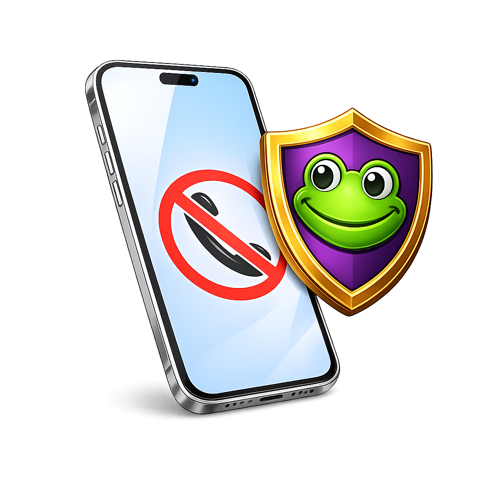

<h1>Stop Démarchage</h1>

<strong>Blocage automatique des appels de démarchage</strong>

## À propos de l'application

Stop Démarchage est une application Android conçue pour filtrer les appels indésirables.

Elle bloque automatiquement les numéros français réservés par l'ARCEP pour le démarchage,
ainsi que les appels de numéros masqués : le téléphone ne sonne pas et l'appel est rejeté.
Les appels ainsi bloqués restent visibles dans l'historique des appels, et l'interlocuteur 
peux laisser un message vocal.

## Sécurité et confidentialité

- **Aucune donnée n'est collectée**
- **Aucune donnée n'est transmise à des tiers**
- **Aucun compte utilisateur n'est nécessaire**
- **L'application ne communique avec aucun serveur distant**
- **La recherche dans les contacts est effectuée localement sur le téléphone.**
- **La journalisation de diagnostic, lorsqu'elle est activée, 
conserve temporairement des traces dans l'espace privé de l'application.**

## Aperçu

## Fonctionnalités

- **Filtrage des préfixes** : bloque les appels provenant des numéros dont le préfixe est dans la liste de l'ARCEP.
- **Blocage des numéros masqués** : permet de bloquer les appels dont le numéro n'est pas présenté (appel masqué).
- **Blocage des numéros hors contacts** : permet de bloquer les appels provenant de numéros qui ne figurent pas dans le carnet d'adresses. Cette option nécessite l'autorisation d'accès aux contacts.
- **Filtrage activable à tout moment** : l'option de filtrage des appels masqués peut être désactivée si besoin, puis réactivée, à tout moment.
- **Fonctionnement automatique** : une fois configurée, l'application filtre les appels en arrière-plan sans aucune intervention nécessaire.

## Télécharger Stop Démarchage

La dernière version de l'application est disponible ici :
[📥 Télécharger](https://github.com/LissusMoam/stop-demarchage-distribution/releases/latest/download/app-release.apk)

## Installation

1. Téléchargez le package depuis le lien ci-dessus
2. Ouvrez le fichier sur votre téléphone
3. Android demandera l'autorisation d'installer l'application depuis cette source
4. Installez l'application puis cliquez sur ouvrir
5. Stop Démarchage demandera si vous souhaitez la définir comme application par défaut pour l'affichage du numéro de l'appelant : c'est le droit de filtrage dont elle a besoin pour fonctionner
6. Vous pouvez ensuite configurer les différentes options de blocage. Si vous activez le blocage des numéros hors contacts, Android vous demandera l'autorisation d'accès aux contacts.
7. Fermez l'écran d'accueil : plus aucune autre intervention ne sera ensuite nécessaire

## Préfixes bloqués

Stop Démarchage bloque actuellement les appels provenant des préfixes suivants :

0162, 0163, 02688, 02689, 0270, 0271, 0377, 0378, 0424, 0425, 0568, 0569, 05987, 05988, 05989, 09475 à 09479, 0948 et 0949

Source : [Arcep – La numérotation](https://www.arcep.fr/la-regulation/grands-dossiers-thematiques-transverses/la-numerotation.html)

## Numéros masqués

Stop Démarchage permet de bloquer les appels provenant de numéros masqués qui sont majoritairement des appels frauduleux, mais depuis le 1er janvier 2026 lorsqu'un appel provenant de l'étranger présente un numéro mobile français (06 ou 07) qui n'a pas pu être authentifié, l'opérateur doit masquer l'identifiant d'appelant.
Il est donc possible, si besoin, de désactiver ce blocage dans Stop Démarchage.

Source : [Arcep – Plan de numérotation](https://www.arcep.fr/actualites/actualites-et-communiques/detail/n/plan-de-numerotation-021225.html)

## Numéros hors contacts

Cette option permet de bloquer automatiquement les appels provenant de numéros qui ne sont pas enregistrés dans le carnet d'adresses.
Lorsqu'elle est activée, l'application vérifie localement si le numéro appelant figure dans les contacts du téléphone. Si le numéro n'est pas trouvé, l'appel est bloqué.
L'accès aux contacts est demandé par Android lors de la première activation de cette option. Aucun contact n'est transmis à l'extérieur du téléphone.
Cette fonctionnalité peut être activée ou désactivée à tout moment.